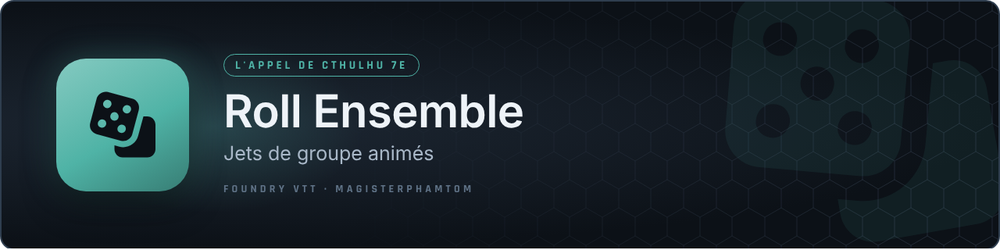

<p align="center"></p>

# Roll Ensemble — CoC7

Module Foundry VTT (v13 / v14) pour **L'Appel de Cthulhu 7e édition** (système CoC7, testé avec la 8.15).

Le Gardien lance **un jet pour plusieurs personnages à la fois** : une fenêtre animée s'ouvre chez tous les joueurs, les chiffres défilent, puis les résultats se révèlent un par un avec leur palier de réussite. Un récapitulatif est posté dans le chat à la fin.

Utile pour une fuite dans les catacombes, une recherche d'indices à plusieurs, un jet de Chance pour tout le groupe, ou un face-à-face entre deux équipes.

## Ce que fait le module

- **Bannière chez tout le monde** (nouveau en 1.1) : un bandeau s'affiche sur l'écran de chaque joueur avec le nom du jet, le d100 et les dés bonus/malus, et les portraits des personnages choisis. Chaque joueur clique sur **Lancer !** sous son portrait ; tout le monde voit les résultats apparaître en direct, puis le bilan du groupe. Le Gardien peut lancer à la place d'un joueur absent.
- **Carte de chat récapitulative** (nouveau en 1.1) : tous les participants avec leur portrait, leur score, le jet, une coche verte (réussite), une croix rouge (échec), une étoile (01, réussite critique), une tête de mort (maladresse), une couronne pour le meilleur, et le bilan (« 3 réussites sur 5 », « Tout le groupe réussit ! », équipe gagnante).
- **01 et maladresses** (nouveau en 1.1) : si le module **Critiques du Mythe** est actif, ses cartes plein écran s'affichent, aux couleurs de l'époque (plusieurs critiques passent l'un après l'autre).
- **Compteur de Chance** (1.3) : sous chaque jet raté, le joueur voit ce qu'il a, ce qu'il faut dépenser pour réussir et ce qui lui restera (« Chance 45 − 15 = reste 30 »), ou « il en faut N » s'il n'en a pas assez ; après dépense, « Chance −15 (reste 30) » sur la bannière et dans le chat.
- **Pousser le jet ou dépenser de la Chance** (1.2) : après les jets, ceux qui ont échoué voient « Pousser », « Chance −N » et ✓ sous leur portrait. Un jet poussé raté est signalé ; la Chance est retirée de la fiche. Pas pour la Chance ni la SAN, ni sur un jet poussé. Le Gardien peut tout valider d'un clic.
- **Expérience cochée** (1.2) : une réussite au premier jet coche la case d'expérience de la compétence, comme un jet normal de CoC7. Règle : pas d'expérience si le jet a été poussé ou si de la Chance a été dépensée (ni en jet caché).
- **Règle du groupe** (1.2) : chacun pour soi, un seul suffit, tous doivent réussir, ou la majorité ; la bannière donne le verdict du groupe en vert ou en rouge.
- **Contre un adversaire** (1.2) : la Discrétion du groupe contre l'Écouter du garde, par exemple. Le Gardien lance pour l'adversaire (son jet peut rester caché) ; chaque investigateur l'emporte ou est battu (meilleur palier, puis plus haute compétence).
- **Lancers favoris** (1.2) : le bouton « Favori » crée une macro dans ta barre ; un clic relance le même lancer (aux joueurs connectés, sinon le Gardien lance), Maj + clic ouvre la préparation remplie.
- **Jet de SAN de groupe** (1.2) : choisis Santé mentale et indique la perte (ex. 1/1D6) ; elle est tirée et retirée des fiches (maladresse = perte maximale), avec un rappel du jet d'INT à partir de 5 points.
- **PNJ et joueurs absents** (1.2) : avec « Envoyer aux joueurs », le Gardien lance tout de suite pour ceux qui n'ont pas de joueur connecté.
- **Léger pour le processeur** (1.2) : une seule petite boucle d'animation pour tous les chiffres qui défilent, pas de flou d'arrière-plan, animations coupées si l'ordinateur demande moins de mouvements.
- **Dice So Nice** : les dés roulent en 3D chez tout le monde (dés des dizaines du système CoC7 + dé des unités, avec les dés bonus et malus), puis le résultat s'affiche sur la bannière.
- **Résultats cachés** (interrupteur dans la préparation) : les joueurs voient qui a lancé, pas le résultat ; seul le Gardien voit les chiffres, les dés 3D et la carte de chat.
- **Thème à la volée** (1.4) : menu déroulant en haut de la fenêtre de préparation pour choisir le thème de ce lancer (la fenêtre change tout de suite ; le choix est gardé jusqu'au rechargement et enregistré dans les favoris).
- **Six thèmes** : Classique, Années 20, New York années 20, Par-delà les Montagnes Hallucinées, New York 2026, Antarctique 2026. En « Automatique » (par défaut), le thème suit l'époque choisie avec **Bascule d'époque**, sinon le thème des **Cartes de chat thématiques**.
- **Compétences du système** : le jet utilise la valeur réelle de chaque fiche (compétences, caractéristiques, Chance, Santé Mentale). Si un participant n'a pas la compétence, c'est signalé.
- **Règles CoC7** : dés bonus et malus (de ×1 à ×2), modificateur en pourcentage, paliers Échec critique / Échec / Réussite normale / difficile / extrême / critique.
- **Difficulté requise** (facultative) : chaque résultat est comparé à un palier minimum, affiché « Réussi » ou « Échoué ».
- **Mode Équipes (jet d'opposition)** : les participants sont répartis en équipe A et équipe B. On compare le meilleur palier de chaque équipe ; à égalité de palier, la compétence la plus haute l'emporte, sinon c'est une égalité.
- **Le Gardien lance, ou les joueurs lancent** : au choix, tout est lancé immédiatement par le Gardien, ou une **requête de jet** est envoyée aux joueurs propriétaires des personnages choisis, qui lancent eux-mêmes leurs dés. Le résultat se finalise tout seul quand tout le monde a répondu.
- **Animation et sons** : durée du défilement, délai entre chaque participant, fermeture automatique, sons de lancement, de victoire et d'échec critique.

## Installation

Foundry → Modules complémentaires → Installer un module → coller le lien du manifeste :

```
https://github.com/magisterphamtom/roll-ensemble-coc7/releases/latest/download/module.json
```

## Utilisation (Gardien)

1. Ouvrir la préparation : bouton **dés** dans la barre de gauche (outils des jetons, visible du Gardien seul), macro **Lancer de groupe** (créée au premier lancement dans le dossier « Outils CoC7 », avec son icône), ou bouton **Lancer Groupé CoC7** au-dessus du chat. Avec le module **Commandes Stream Deck**, la macro « SD 45 · Lancer de groupe » est créée (touche **Alt+F21**) et l'image de touche est fournie dans `icons/stream-deck/SD45.png`.
2. Donner un nom au lancer (ex. « Fuite dans les catacombes »).
3. Choisir les participants : cliquer leur vignette, cliquer directement leur jeton sur la scène, glisser des acteurs, ou ajouter les jetons sélectionnés. Des filtres montrent les joueurs seuls ou les PNJ.
4. Choisir la compétence ou la caractéristique dans la liste (elle s'appuie sur les fiches des participants sélectionnés).
5. Régler si besoin : dés bonus/malus par défaut (modifiables participant par participant), modificateur, difficulté requise, mode Équipes.
6. Cliquer sur **Lancer !** pour que le Gardien lance tout de suite, ou sur **Envoyer la requête** pour que les joueurs lancent eux-mêmes leurs dés.

Chaque participant garde son badge « Inclus » ou « Exclu » : un clic dessus décide s'il reçoit ou non la requête.

## Réglages

Dans les réglages du module (Gardien) :

| Réglage | Par défaut |
|---|---|
| Activer les sons | oui |
| Son de lancement, son de victoire, son d'échec critique (fichiers audio au choix) | aucun |
| Durée de l'animation (ms) | 1500 |
| Délai entre chaque participant (ms) | 500 |
| Fermeture automatique (secondes, 0 = manuelle) | 8 |
| Thème de la bannière et de la carte | automatique (suit l'époque) |
| Affichage du lancer : bannière (portraits) ou fenêtre (ancienne présentation) | bannière |
| Effets des 01 et maladresses (module Critiques du Mythe) | oui |
| Pousser le jet et dépenser la Chance | oui |
| Cocher l'expérience | oui |

Une maladresse suit la règle de CoC7 : 100, ou 96 à 100 si la valeur visée est inférieure à 50. Si une maladresse survient pendant le lancer, le son d'échec critique remplace le son de victoire.

## Compatibilité

- Foundry VTT v13 (minimum) et v14 (vérifié en 14.368). Système CoC7 8.14 à 9.2.
- Système **CoC7** requis pour la lecture des compétences ; avec un autre système, le module prévient dans la console et ne sait pas lire les fiches.
- Interface en **français** et en **anglais**.
- Les jets en équipe de plusieurs joueurs passent par les sockets de Foundry : le module doit être activé chez le Gardien et chez les joueurs.

## Crédits

Polices des thèmes (dossier `fonts/`, licence SIL OFL 1.1) : Limelight, Poiret One, IM Fell English, Inter, Rajdhani.


Code : magisterphamtom (licence MIT).
