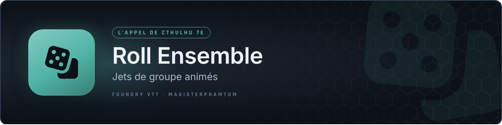

<p align="center"></p>

# Roll Ensemble — CoC7

Module Foundry VTT (v13 / v14) pour **L'Appel de Cthulhu 7e édition** (système CoC7, testé avec la 8.15).

Le Gardien lance **un jet pour plusieurs personnages à la fois** : une fenêtre animée s'ouvre chez tous les joueurs, les chiffres défilent, puis les résultats se révèlent un par un avec leur palier de réussite. Un récapitulatif est posté dans le chat à la fin.

Utile pour une fuite dans les catacombes, une recherche d'indices à plusieurs, un jet de Chance pour tout le groupe, ou un face-à-face entre deux équipes.

## Ce que fait le module

- **Compétences du système** : le jet utilise la valeur réelle de chaque fiche (compétences, caractéristiques, Chance, Santé Mentale). Si un participant n'a pas la compétence, c'est signalé.
- **Règles CoC7** : dés bonus et malus (de ×1 à ×2), modificateur en pourcentage, paliers Échec critique / Échec / Réussite normale / difficile / extrême / critique.
- **Difficulté requise** (facultative) : chaque résultat est comparé à un palier minimum, affiché « Réussi » ou « Échoué ».
- **Mode Équipes (jet d'opposition)** : les participants sont répartis en équipe A et équipe B. On compare le meilleur palier de chaque équipe ; à égalité de palier, la compétence la plus haute l'emporte, sinon c'est une égalité.
- **Le Gardien lance, ou les joueurs lancent** : au choix, tout est lancé immédiatement par le Gardien, ou une **requête de jet** est envoyée aux joueurs propriétaires des personnages choisis, qui lancent eux-mêmes leurs dés. Le résultat se finalise tout seul quand tout le monde a répondu.
- **Animation et sons** : durée du défilement, délai entre chaque participant, fermeture automatique, sons de lancement, de victoire et d'échec critique.

## Installation

Foundry → Modules complémentaires → Installer un module → coller le lien du manifeste :

```
https://github.com/magisterphamtom/roll-ensemble-coc7/releases/latest/download/module.json
```

## Utilisation (Gardien)

1. Dans le chat, cliquer sur le bouton **Lancer Groupé CoC7** (au-dessus de la zone de saisie, visible uniquement du Gardien).
2. Donner un nom au lancer (ex. « Fuite dans les catacombes »).
3. Choisir les participants : cliquer leur vignette, cliquer directement leur jeton sur la scène, glisser des acteurs, ou ajouter les jetons sélectionnés. Des filtres montrent les joueurs seuls ou les PNJ.
4. Choisir la compétence ou la caractéristique dans la liste (elle s'appuie sur les fiches des participants sélectionnés).
5. Régler si besoin : dés bonus/malus par défaut (modifiables participant par participant), modificateur, difficulté requise, mode Équipes.
6. Cliquer sur **Lancer !** pour que le Gardien lance tout de suite, ou sur **Envoyer la requête** pour que les joueurs lancent eux-mêmes leurs dés.

Chaque participant garde son badge « Inclus » ou « Exclu » : un clic dessus décide s'il reçoit ou non la requête.

## Réglages

Dans les réglages du module (Gardien) :

| Réglage | Par défaut |
|---|---|
| Activer les sons | oui |
| Son de lancement, son de victoire, son d'échec critique (fichiers audio au choix) | aucun |
| Durée de l'animation (ms) | 1500 |
| Délai entre chaque participant (ms) | 500 |
| Fermeture automatique (secondes, 0 = manuelle) | 8 |

Si un échec critique survient pendant le lancer, le son d'échec critique remplace le son de victoire.

## Compatibilité

- Foundry VTT v13 (minimum) et v14 (vérifié en 14.368).
- Système **CoC7** requis pour la lecture des compétences ; avec un autre système, le module prévient dans la console et ne sait pas lire les fiches.
- Interface en **français** et en **anglais**.
- Les jets en équipe de plusieurs joueurs passent par les sockets de Foundry : le module doit être activé chez le Gardien et chez les joueurs.

## Crédits

Code : magisterphamtom.
